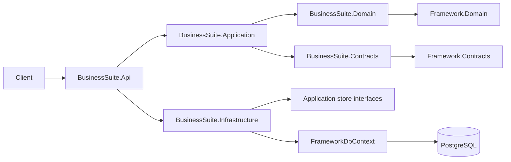
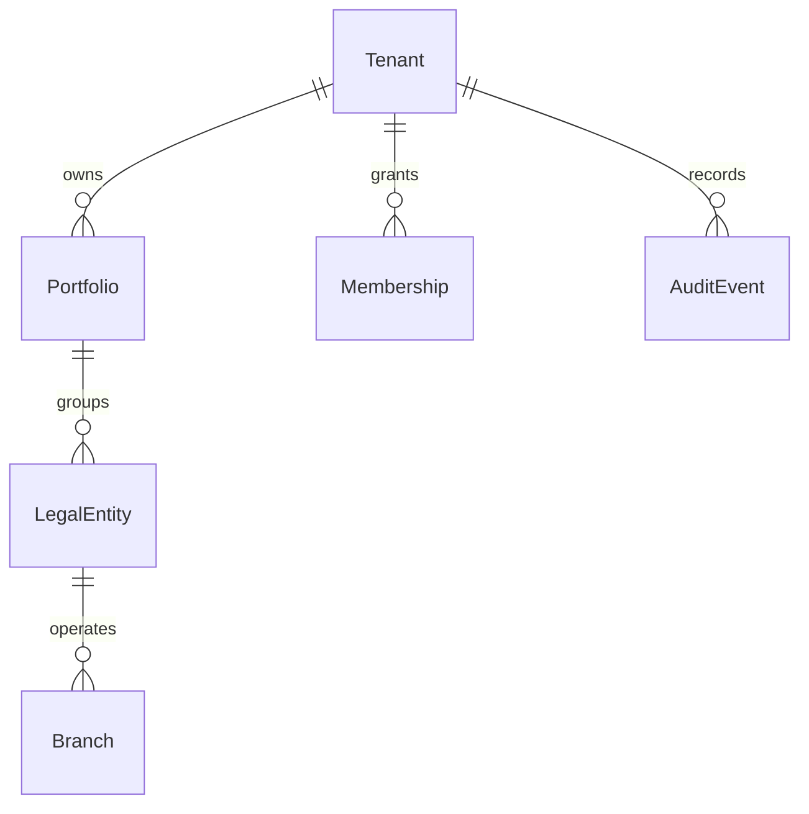

# Architecture and backend delivery scope

## Reference basis

Reviewed source documents: **Multi_Business_Platform_Technical_Architecture.pdf**, version 1.0, 11 October 2026, and **Multi_Business_Platform_Functional_Roadmap.pdf**, version 1.0, 11 October 2026, supplied from the user's Downloads folder. They are product/architecture references; their proposed actions do not independently authorize deployment, messaging, integrations or statutory compliance decisions. This implementation follows the user's backend-only instruction and foundation-first scope.

Technical reference sections 1-3, 5-6, 11 and 14 inform the initial architecture. Functional reference Phase 1 and portfolio management requirements inform the implemented hierarchy. Document storage, invitations and the rest of Phase 1 remain future work.

## Decisions

| Decision | Rationale / consequence |
| --- | --- |
| Modular monolith with Clean Architecture | One deployable API, explicit Portfolio, IdentityAccess and Audit namespaces. Domain and Contracts remain independent; Application has no EF/host dependency. Split assemblies by module when boundaries grow, rather than creating empty services now. |
| Reuse sibling Framework projects | Reuses entity abstractions, DomainException, CommonResult and derived FrameworkDbContext. Package baseline comes from Framework. Framework.Application and independently referenced AIFramework.Core are available for future scoped workflows. No copy of Framework's host is created. |
| Explicit scoped store over generic CRUD | Framework's generic repository/controller abstractions do not enforce this hierarchy's memberships. Application APIs expose business-specific operations and never return an unscoped IQueryable. Store queries explicitly constrain TenantId; composite tenant/parent keys prevent cross-tenant hierarchy writes. |
| PostgreSQL first | One database, schemas `portfolio`, `identity`, `audit`, with a reviewed migration. Framework supports SQL Server, but BusinessSuite requires a dedicated migration set and integration verification before enabling it. |
| Separate tenant, portfolio, entity and branch IDs | Tenant represents isolation; portfolio represents grouping; legal entity represents a registered company; branch represents location. Their identities are never interchangeable. |
| JWT + persisted grants | Authenticated tenant/subject claims identify the request. Active memberships authorize resource access. There is no implicit platform-admin access to customer data and no unauthenticated Development access. |
| Atomic audit on creation | Business record and audit event commit in one EF SaveChanges transaction. Audit stores actor, action, resource ID, UTC time and correlation ID without full financial payloads. Audit is not yet backed by immutable storage or separate database privileges. |
| Financial modules deferred | This foundation stores hierarchy and currency settings only. No ledger, calculation, FX conversion, statutory reporting or automated AI financial actions are claimed. |

## Authorization matrix for implemented operations

| Membership | Read | Create |
| --- | --- | --- |
| Tenant Owner / Manager | All tenant hierarchy resources | Portfolios, entities, branches |
| Portfolio Owner / Manager | Assigned portfolio and descendants | Entities and branches under it |
| Entity Owner / Manager | Assigned entity and branches | Branches under it |
| Branch Owner / Manager | Assigned branch | None of the current hierarchy creation operations |
| Accountant / Operator / Auditor | Assigned scope and descendants | None of the current hierarchy creation operations |
| Expired, future or absent membership | None | None |

Membership assignment/revocation HTTP APIs and invitations are deliberately deferred. Only a trusted bootstrap command grants the initial tenant owner. Test fixtures exercise narrower grants. Future grant workflows must validate scope existence, tenant ownership, delegation permissions and escalation restrictions before storing a membership. Role semantics for invoice approval, payroll and close will be defined separately; being a hierarchy Manager does not pre-authorize those future operations.

Memberships are evaluated against server UTC time on each operation. Tenant comes from the validated claim, never a body or query parameter. List filters apply access before pagination. Queries use explicit tenant predicates rather than global filters; raw SQL, new stores and privileged/background paths require their own tenant-boundary tests.

## Data model and constraints

All scoped records have TenantId. LegalEntity references `(TenantId, PortfolioId)` and Branch references `(TenantId, LegalEntityId)` through composite foreign keys. Registered company identifiers are unique per tenant and country. Membership uniqueness is `(TenantId, UserId, Scope, ScopeId)`; changes/regrants should update the grant through an audited future workflow. No generic delete/update routes are exposed.

Country code validates two-letter syntax, including `XK`; this is not jurisdiction certification. Locale uses .NET culture validation, timezone uses platform timezone data, and supported currencies come from an explicit initial catalog. Registration identifiers are trimmed but not country-normalized. Jurisdiction-specific validation belongs in reviewed adapters.

## Next increments

1. Complete foundation: membership/invitation workflows; append-only audit enforcement and query APIs; secure object storage with malware status and retention; transactional outbox/worker; OpenTelemetry export; real-provider isolation tests; infrastructure deployment and recovery validation.
2. Operational MVP: suppliers, sales, purchases, expenses and invoice review. Add decimal Money, explicit rounding, approval state transitions, optimistic concurrency and idempotency before financial mutations. Preserve source documents and immutable approved records.
3. Reporting: deterministic entity metrics, read models, FX provenance, completeness, intercompany reconciliation and management consolidation. Decide full double-entry scope explicitly before implementing postings.
4. Intelligence: reuse AI-Framework's Core contracts and selected adapters behind BusinessSuite authorization and durable document metadata. Resolve entity/branch permissions before retrieval. A single AIFramework ScopeId alone does not model this hierarchy. Ground answers in deterministic reporting APIs; require human approval for financial effects.
5. Integrations and accounting: canonical imports, retry/dead-letter handling, bank/POS adapters, reconciliation and period close. Add effective-dated compliance interfaces and a reviewed Kosovo adapter before claiming country support.

The remaining functional phases (additional jurisdictions, billing, metering, forecasts and enterprise controls) follow validated product scope. Backend readiness does not imply completion of frontend acceptance scenarios.

## Verification and limitations

The automated suite exercises HTTP hierarchy creation and Location links, tenant-scoped reads and parents, branch IDOR, role/validity restrictions, claims, domain validation, relational foreign keys, atomic audit rollback, OpenAPI and layer dependencies. SQLite verifies relational behavior but does not exercise PostgreSQL-specific unique-error mapping or production OIDC discovery. Generated PostgreSQL SQL and migration model drift are checked separately.

Remaining release gates include resolving Framework's AutoMapper advisory, reviewing the SDK/runtime support baseline with Framework, production identity/MFA setup, PostgreSQL migration smoke tests, request limits/load tests, backup restore tests and secret/network configuration. The initial BusinessSuite foundation did not modify Framework source; the subsequent AI extraction separates its AI capabilities into AI-Framework.
